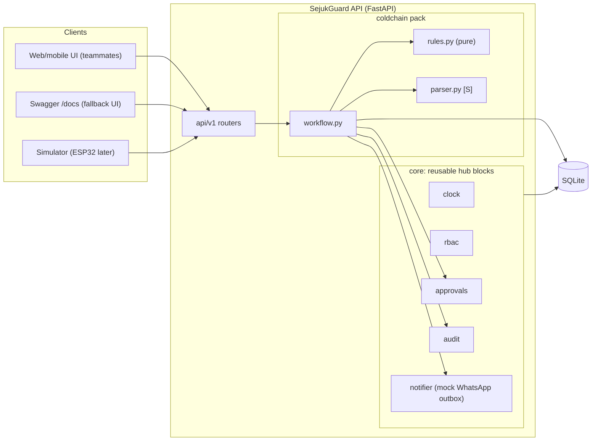
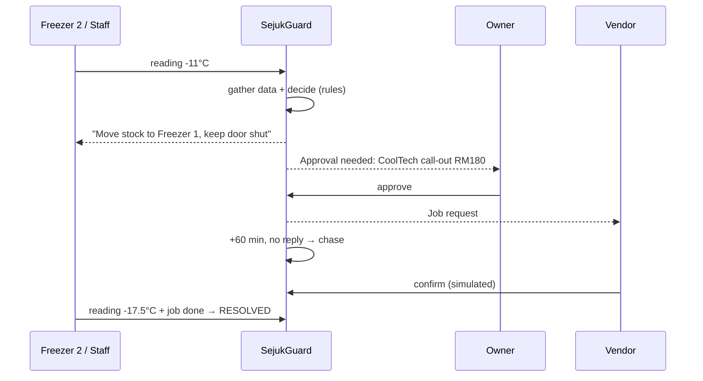

# SejukGuard — Backend Build Plan

**5-day sprint → Iteration 1 (Preliminary Round)**

| | |
|---|---|
| **Challenge** | Domain 2 · Orbyte Smart SME Challenge: *Less Busywork, Better Business* (Alpha Red Solutions) |
| **Product** | *SejukGuard* (working name): cold-chain & equipment guardian for small food businesses |
| **Audience** | The two backend coders (Dev A, Dev B). 🤝 marks hand-offs to the UI/design and pitch teammates |
| **Deadline** | Plan submits **Day 5 = Sun 25 Oct 2026, evening** (deadline assumed Mon 26 Oct — confirm the exact time) |
| **Stack** | Python 3.12 · FastAPI · SQLModel + SQLite · pytest · GitHub Actions · Replit (or Render) |
| **AI** | Optional, off the critical path. Anthropic Python SDK only if time allows |

> **Using an AI coding assistant?** Give it **one task section at a time, in order**. All steps use checkboxes (`- [ ]`) so you can track progress on GitHub.

---

## Key Takeaways

> **The whole plan in 8 bullets**
>
> 1. **Build one thing well:** the freezer-failure journey — **trigger → connected data → decision → human approval → visible outcome + log** — running live from a public GitHub repo.
> 2. **Rules decide, AI doesn't.** Severity, vendor choice, approver and money are deterministic rules that write plain-language reasons. AI is optional and never on the critical path.
> 3. **Work in priority tiers:** **[M] Must** (T1–T11) first. **[S] Should** (T12, staff messages) only if the golden test is green by **Day 4, 13:00**. **[C] Could** goes in the proposal as roadmap.
> 4. **The demo script *is* the main test.** `test_golden_journey_freezer_failure` runs on every PR. If it's red, the demo is broken.
> 5. **Deploy on Day 1.** The UI team builds from the example JSON in §10 straight away and switches to the real API on Day 3 evening.
> 6. **Freeze code at 12:00 on Day 5.** After that, only fixes that keep the golden test green.
> 7. **Hardest risk = live demo failure.** Fallbacks, in order: local run → Swagger `/docs` → `demo_journey.py` script → recorded video.
> 8. **Never invent numbers.** All data is synthetic, and benefit figures come only from interviews or the `/v1/metrics` endpoint.

---

## Table of Contents

- **Part A — Product**
  - [1. The Product in One Paragraph](#1-the-product-in-one-paragraph)
  - [2. Why This Idea](#2-why-this-idea)
- **Part B — Timeline**
  - [3. 5-Day Timeline and Priority Tiers](#3-5-day-timeline-and-priority-tiers)
  - [4. Quick Problem Validation](#4-quick-problem-validation)
- **Part C — System Design**
  - [5. Architecture](#5-architecture)
  - [6. Journey Mapped to Code](#6-journey-mapped-to-code)
  - [7. Data Model](#7-data-model)
  - [8. Decision Rules](#8-decision-rules)
  - [9. Roles and Permissions](#9-roles-and-permissions)
  - [10. API Contract](#10-api-contract)
  - [11. Seed Data (Demo World)](#11-seed-data-demo-world)
  - [12. Where AI Is Used](#12-where-ai-is-used)
- **Part D — Engineering Setup**
  - [13. Repo Layout and Config Files](#13-repo-layout-and-config-files)
  - [14. Global Constraints](#14-global-constraints)
  - [15. Review Focus](#15-review-focus)
  - [16. How Every Task Is Done](#16-how-every-task-is-done)
- **Part E — Build Tasks**
  - [17. Tasks T1 to T13](#17-tasks-t1-to-t13)
- **Part F — Ship It**
  - [18. Working with the UI Team](#18-working-with-the-ui-team)
  - [19. Demo Script (Golden Journey)](#19-demo-script-golden-journey)
  - [20. Risks and Fallbacks](#20-risks-and-fallbacks)
  - [21. Proposal Inputs from Backend](#21-proposal-inputs-from-backend)
  - [22. Definition of Done (Iteration 1)](#22-definition-of-done-iteration-1)
  - [23. Roadmap (After Iteration 1)](#23-roadmap-after-iteration-1)
- **Appendix**
  - [A. Quick Reference Card](#a-quick-reference-card)
  - [B. Glossary](#b-glossary)

---

## Part A — Product

### 1. The Product in One Paragraph

Small food businesses (bakeries, cafés, frozen-food sellers, mini-marts) keep thousands of ringgit of stock in a few fridges and freezers. When a unit starts failing, problems pile up:

- Nobody notices until stock is already soft.
- Staff send a panicked WhatsApp message.
- The owner, often at home in the evening, has to figure out which unit it is, what's inside, whether it's under warranty, and which technician to call. Then they chase that technician.

**SejukGuard** handles this end to end:

- It watches temperature readings.
- It works out how much stock is at risk and where to move it.
- It picks the right vendor (warranty partner first, then the fastest or cheapest).
- It asks **the right person** to approve the call-out, based on cost.
- It dispatches the job, chases the vendor if they don't reply, and logs every step.

### 2. Why This Idea

Five ideas were compared against the preliminary rubric (Innovation 30 · Fit 25 · Feasibility 25 · Clarity 20). These are the team's own estimates:

| Idea | Weighted /5 | Why / why not |
|---|:-:|---|
| **Cold-chain & equipment guardian (chosen)** | **4.25** | Original, uses our mech/EEE background, connects several kinds of data (assets + stock + vendors + approvals), and the demo ends on a clear RM figure |
| Smart reorder & supplier chaser | 4.18 | Safest fit, but likely a common choice; good **roadmap link** (reorder the stock that spoiled) |
| Overdue payment chaser | 3.98 | Easiest to build, least original |
| WhatsApp enquiry → quotation | 3.85 | Good AI use, more AI risk |
| Utility-bill watchdog | 3.55 | Original, but the "action" step is weak |

> **Key takeaways — Part A**
> - The problem is specific: **late detection + unknown RM at risk + owner chasing technicians at night**.
> - We chose the most original idea that still has a concrete money outcome (RM1,850 saved in the demo).
> - The runner-up (smart reorder) becomes a roadmap item that proves the engine is reusable.

---

## Part B — Timeline

### 3. 5-Day Timeline and Priority Tiers

**Assumptions:**

- "Deadline in 5 days" was said on **Wed 21 Oct 2026**, so the deadline is around Mon 26 Oct. **Check the exact submission time.**
- The plan **submits on Day 5 (Sun 25 Oct) evening**, leaving a buffer either way.
- Each dev has about 6–8 hours a day.

#### 3.1 Priority tiers (cut from the bottom when behind)

| Tier | Meaning | Tasks |
|---|---|---|
| **[M] Must** | Without it there is no live journey, and Feasibility (25%) collapses | T1–T11 |
| **[S] Should** | Build only if T10 (golden test) is green by **Day 4, 13:00** | T12 staff fault message (rules parser + "which unit?" hand-off) |
| **[C] Could** | Build only if everything above is done. Otherwise it goes in the proposal as roadmap | T13 LLM parser + the "Could" list in §17 |

#### 3.2 Day by day

| Day | Dev A — "decision brain" | Dev B — "platform & interfaces" | 🤝 Team |
|---|---|---|---|
| **1 · Wed 21** | Read Part C together (1 h). **T2** models + seed. **T4** rules (start) | Create **public** repo + board (30 min). **T1** skeleton + CI + **deploy skeleton**. **T3** core (start) | UI starts building from the §10 JSON examples (mock data). Pitch team: proposal outline + 2–3 quick interviews (§4) |
| **2 · Thu 22** | **T4** rules finish. **T6** reading → incident (**merge `open_incident` by end of day**) | **T3** finish. **T5** approvals. **T8** read APIs (start) | Interviews done; proposal draft v1 |
| **3 · Fri 23** | **T7** approve → dispatch → resolve | **T8** finish + metrics. **T9** sim advance/sensor + vendor chase | **Evening:** UI switches from mock data to the real deployed API |
| **4 · Sat 24** | **AM: T10** golden-journey test. **PM:** fix bugs found with UI; help with T12 | **AM: T11** deploy + demo driver. **PM: T12 [S]** if T10 is green by 13:00 | **Evening:** rehearsal 1 (timed, < 3 min) |
| **5 · Sun 25** | **12:00 feature freeze.** README, architecture diagram, numbers for proposal (§21) | **12:00 feature freeze.** Record backup video; tag `v0.1-prelim` | Rehearsal 2 → final proposal → **SUBMIT by evening** |

**After 12:00 on Day 5 you only change code to fix the demo, and every change must keep the golden test green.**

### 4. Quick Problem Validation

🤝 *Owned by the non-coders.* Validating with real owners is a good-to-have, but it gives the proposal real numbers. With 5 days, the pitch team does **2–3 short WhatsApp or phone chats** on Days 1–2. The devs don't join.

**Rules:** say it's for a student hackathon, get verbal consent, and **don't record names, business names or numbers**. Nothing goes in the repo.

**Questions:**

1. When did a fridge or freezer last fail? How long until you noticed, and how long until a technician came?
2. Roughly how much stock (RM) did you lose, and how much is usually inside?
3. Who is allowed to call or pay a technician? **Up to what amount would you let a supervisor decide without you?** (This validates the RM150 threshold.)
4. Do you write temperature logs on paper? How many minutes a day?

If no one can be reached in time, the proposal says "validation interviews planned for the next round". **Never invent answers.**

> **Key takeaways — Part B**
> - **Days 1–3 build, Day 4 integrates and tests, Day 5 freezes and submits.**
> - **Two merges a day** keep both devs unblocked. Dev A must merge `open_incident` by the end of Day 2.
> - The **13:00 Day 4 gate** decides whether T12 happens. If the golden test isn't green, skip T12.
> - Interviews are optional but valuable. Question 3 checks our RM150 approval threshold against reality.

---

## Part C — System Design

### 5. Architecture

**One Python FastAPI service, split into two parts:**

- **`core/`** — reusable "Orbyte hub" building blocks: clock, roles & permissions, approvals, audit log, notifier.
- **`coldchain/`** — the domain pack: rules, workflow, and later a message parser.



### 6. Journey Mapped to Code

| Brief step | What happens | Where |
|---|---|---|
| **1. Trigger** | Out-of-range temperature reading ([S]: or a staff fault message) | `POST /v1/readings` → `workflow.handle_reading` |
| **2. Connected data** | Unit details, warranty, stock inside (RM + volume), other units' free space, vendors, business policy | `workflow.gather_context` |
| **3. Decision logic** | Severity, stock at risk, backup unit, vendor, approver role, plain-language reasons | `rules.decide` (pure function) |
| **4. Human approval** | Approval request routed by amount; wrong role gets 403 and is logged | `core/approvals.py`, `POST /v1/approvals/{id}/approve` |
| **5. Visible outcome + log** | Vendor job created and messaged, staff instructed, vendor chased, incident resolved, every step in the audit log | `workflow.on_approval_decided`, `scheduler.run_scheduled_checks`, `GET /v1/audit` |



### 7. Data Model

SQLModel tables live in `app/models.py`. All enums live in `app/enums.py` to avoid circular imports.

| Table | Fields |
|---|---|
| `Business` | `id`, `name`, `kind`, `supervisor_limit_sen: int = 15000` |
| `User` | `id`, `business_id`, `name`, `role: Role`, `phone` (fake, e.g. `"demo-0001"`) |
| `Asset` | `id`, `business_id`, `name`, `type: "freezer"\|"chiller"`, `aliases: list[str]` (JSON), `min_c`, `max_c`, `capacity_l`, `warranty_until: date \| None`, `warranty_vendor_id: str \| None` |
| `StockItem` | `id`, `business_id`, `asset_id`, `name`, `qty`, `unit`, `unit_cost_sen: int`, `volume_l` |
| `Vendor` | `id`, `business_id`, `name`, `services: list[str]` (JSON asset types), `callout_fee_sen: int`, `sla_hours: int`, `phone` |
| `Reading` | `id`, `asset_id`, `temp_c`, `recorded_at`, `source: "staff"\|"sensor"\|"sim"` |
| `Incident` | `id`, `business_id`, `asset_id: str \| None` (None while NEEDS_INFO), `trigger: "reading"\|"report"`, `reporter_id`, `report_text`, `symptom`, `severity`, `status`, `decision: dict` (JSON), `stock_at_risk_sen`, `created_at`, `resolved_at` |
| `ApprovalRequest` | `id`, `business_id`, `subject_type` (`"incident"`), `subject_id`, `action` (`"dispatch_vendor"`), `amount_sen`, `required_role`, `status`, `decided_by`, `decided_at`, `note`, `created_at` |
| `ServiceJob` | `id`, `business_id`, `incident_id`, `vendor_id`, `status`, `requested_at`, `confirmed_at`, `eta`, `done_at`, `chase_count: int = 0`, `last_chased_at` |
| `Message` | `id`, `business_id`, `to_type: "user"\|"vendor"`, `to_id`, `channel = "whatsapp_mock"`, `body`, `incident_id`, `created_at` |
| `AuditEvent` | `id` (autoincrement), `business_id`, `at`, `actor_id` (`"system"` or user id), `action`, `entity_type`, `entity_id`, `details: dict` (JSON) |

**Enums (`app/enums.py`):**

```python
class Role(StrEnum):            # rank: staff < supervisor < owner
    STAFF = "staff"
    SUPERVISOR = "supervisor"
    OWNER = "owner"

class Severity(StrEnum):
    NORMAL = "NORMAL"
    WATCH = "WATCH"
    WARNING = "WARNING"
    CRITICAL = "CRITICAL"

class IncidentStatus(StrEnum):
    NEEDS_INFO = "NEEDS_INFO"
    PENDING_APPROVAL = "PENDING_APPROVAL"
    DISPATCHED = "DISPATCHED"
    DECLINED = "DECLINED"
    RESOLVED = "RESOLVED"

class ApprovalStatus(StrEnum):
    PENDING = "PENDING"
    APPROVED = "APPROVED"
    REJECTED = "REJECTED"

class JobStatus(StrEnum):
    REQUESTED = "REQUESTED"
    CONFIRMED = "CONFIRMED"
    DONE = "DONE"

class Symptom(StrEnum):
    NOT_COOLING = "not_cooling"
    TOO_COLD = "too_cold"
    LEAKING = "leaking"
    NOISE = "noise"
    POWER_OFF = "power_off"
    DOOR_ISSUE = "door_issue"
    OTHER = "other"
```

**Audit actions:**

| Tier | Actions |
|---|---|
| **[M]** | `INCIDENT_OPENED`, `SEVERITY_CHANGED`, `APPROVAL_REQUESTED`, `APPROVAL_FORBIDDEN`, `APPROVED`, `REJECTED`, `MESSAGE_SENT`, `JOB_CREATED`, `VENDOR_CHASED`, `VENDOR_CONFIRMED`, `JOB_DONE`, `INCIDENT_RESOLVED`, `WATCH_CLEARED` |
| **[S]** | `NEEDS_INFO`, `CLARIFIED` |
| **[C]** | `PARSE_FALLBACK_USED` |

### 8. Decision Rules

All constants live in `app/coldchain/policy.py`:

```python
# app/coldchain/policy.py — exact values; change them here and in §14 only
CRITICAL_DEVIATION_C = 3.0          # °C outside range → CRITICAL
CRITICAL_DURATION_MIN = 60          # minutes continuously out of range → CRITICAL
WARNING_MIN_STREAK = 2              # consecutive out-of-range readings → WARNING
VALID_TEMP_RANGE = (-40.0, 50.0)    # anything outside is a sensor glitch → 422
READING_WINDOW_H = 3                # hours of readings considered
VENDOR_CHASE_MIN = 60               # minutes before chasing an unconfirmed job
MAX_CHASES = 2
PARSER_MIN_CONFIDENCE = 0.6         # [S] below this → NEEDS_INFO
DEFAULT_SUPERVISOR_LIMIT_SEN = 15000  # RM150.00; stored per Business
```

#### 8.1 Reading validity

A reading outside **−40.0 to +50.0 °C** is rejected with 422 and never stored. This catches classic DS18B20 sensor glitches: **85.0** at power-on and **−127.0** when disconnected.

#### 8.2 Severity

**Out of range** means `temp < min_c` or `temp > max_c`. Deviation is the distance outside the range in °C. Freezers are seeded with `min_c = −35` so "too cold" is not an alarm for them.

**From readings** (`classify_severity`, using the unit's readings from the last 3 h, oldest first):

| # | Condition | Result |
|---|---|---|
| 1 | Latest reading in range | `NORMAL` |
| 2 | Latest deviation **≥ 3.0 °C** | `CRITICAL` |
| 3 | Out of range continuously for **≥ 60 min** | `CRITICAL` |
| 4 | Last **2** readings both out of range | `WARNING` |
| 5 | Otherwise (a single excursion, such as the door being opened) | `WATCH`. No incident. If the next reading is normal, `WATCH_CLEARED` is logged and counted as a false alarm avoided |

**From a staff message [S]** (`severity_from_symptom`): `not_cooling`, `power_off` → `CRITICAL`. Everything else → `WARNING`.

#### 8.3 Stock, backup unit, vendor, approver

- **Stock at risk** = Σ `qty × unit_cost_sen` of the items in the unit. **Volume needed** = Σ `volume_l`.
- **Backup unit** (`pick_backup_unit`): another unit of the **same type**, currently in range, with `free_l ≥ volume needed`. Choose the one with the **most** free space. If there is none, add the reason "No backup space — move stock to an ice box / another outlet" (the human decides).
- **Vendor** (`choose_vendor`):
  1. If `warranty_until ≥ today` and `warranty_vendor_id` is set → use the warranty vendor with a **cost of 0**.
  2. Otherwise, consider vendors whose `services` include the unit type **and that are not `warranty_only`** (a warranty centre doesn't do paid call-outs; without this, RM0 BrandCare would win every WARNING "cheapest" pick). `CRITICAL` → sort by `(sla_hours, callout_fee_sen)`. `WARNING` → sort by `(callout_fee_sen, sla_hours)`. Take the first.
  3. If no vendor is found, set `needs_human = "No vendor services <type> units — assign one"`. No approval is created, and the owner is messaged.
- **Approver** (`required_approver_role`): `cost_sen ≤ business.supervisor_limit_sen` (15000 = RM150.00) → `supervisor`. Above that → `owner`.
  - **Every vendor dispatch needs an approval**, even RM0, because it commits someone's time.
  - Moving stock is an *instruction*, so it is sent to staff immediately without approval.

#### 8.4 De-duplication, chasing, resolution

- **De-duplication:**
  - A unit has at most **one active incident** (`PENDING_APPROVAL` or `DISPATCHED`).
  - More bad readings for the same unit do not create a new incident, approval or approver message.
  - If severity **rises** (WARNING → CRITICAL), update `incident.severity`, log `SEVERITY_CHANGED`, and message the approver(s) once. The pending approval stays as it is. Re-deciding the vendor is on the [C] list.
- **Vendor chase** (`run_scheduled_checks`, run on every `/v1/sim/advance`): a job still `REQUESTED` **60 min** after `requested_at` (or after `last_chased_at`) → send a chase message, `chase_count += 1`, `last_chased_at = now`. Maximum **2** chases. Each call chases a given job **at most once**.
- **Resolution:**
  - `complete_job` → `RESOLVED` unless the latest reading in the last 60 min is out of range. In that case the incident stays `DISPATCHED` and the owner is told "still out of range after repair".
  - A later normal reading on a unit whose job is `DONE` resolves the incident.

#### 8.5 Explainable reasons

**Every decision carries `reasons: list[str]`** in plain language. These reasons are the "explainable decisions" feature, and the UI shows them as-is. Example for Freezer 2:

```text
1. Freezer 2 is at -11.0°C, 4.0°C above its -15.0°C limit → CRITICAL (≥3.0°C)
2. RM1,850.00 of stock inside (4 items, 120 L)
3. Freezer 1 has 180 L free ≥ 120 L needed → move stock there now
4. Warranty expired 2026-03-01 → paid call-out
5. CRITICAL → fastest vendor: CoolTech Refrigeration (4 h, RM180.00)
6. RM180.00 > RM150.00 supervisor limit → owner approval required
```

### 9. Roles and Permissions

Login is simulated with the header **`X-User-Id`**.

| Action | Staff | Supervisor | Owner |
|---|:-:|:-:|:-:|
| Submit reading ([S]: report fault / clarify) | ✅ | ✅ | ✅ |
| View assets, incidents, decision reasons | ✅ | ✅ | ✅ |
| See RM values (stock at risk, call-out cost) | ❌ shown as `null` | ✅ | ✅ |
| View vendors, message outbox | ❌ | ✅ | ✅ |
| Approve/reject call-out ≤ RM150 | ❌ | ✅ | ✅ |
| Approve/reject call-out > RM150 | ❌ | ❌ (403, logged) | ✅ |
| Confirm / complete jobs (on the vendor's behalf in the demo) | ❌ | ✅ | ✅ |
| View audit log & metrics | ❌ | ❌ | ✅ |
| Any data of another business | ❌ (404) | ❌ (404) | ❌ (404) |

**Error codes:**

| Situation | Status |
|---|---|
| Missing or unknown `X-User-Id` | **401** |
| Role too low | **403** |
| Another business's data | **404**. Never 403, so the API doesn't reveal that the record exists |
| `/v1/sim/*` when `DEMO_MODE=false` | **404** (the routes don't exist) |

### 10. API Contract

Prefix `/v1`, **frozen on Day 1**. Changes need both devs and the UI lead to agree, and are logged in `docs/api-changes.md`.

| Method | Path | Min role | Purpose | Tier |
|---|---|---|---|:-:|
| GET | `/health` | public | `{"status":"ok"}` | M |
| GET | `/v1/me` | staff | Current user + permission list | M |
| POST | `/v1/readings` | staff | `{asset_id, temp_c, source}` → `{reading, incident \| null}` | M |
| GET | `/v1/assets` | staff | Units with `status` (latest severity) and latest temp | M |
| GET | `/v1/assets/{id}` | staff | Unit + stock (RM `null` for staff) + last 24 readings | M |
| GET | `/v1/vendors` | supervisor | Vendor list | M |
| GET | `/v1/incidents?status=` | staff | Incident list | M |
| GET | `/v1/incidents/{id}` | staff | Full detail (example below) | M |
| GET | `/v1/approvals?status=PENDING` | supervisor | Pending approvals, each with `can_decide: bool` | M |
| POST | `/v1/approvals/{id}/approve` | by amount | `{note?}` → approval + incident | M |
| POST | `/v1/approvals/{id}/reject` | by amount | `{note}` → approval + incident | M |
| POST | `/v1/jobs/{id}/confirm` | supervisor | `{eta?}` simulated vendor reply | M |
| POST | `/v1/jobs/{id}/complete` | supervisor | Technician finished | M |
| GET | `/v1/messages?to_id=` | supervisor | Outbox (mock WhatsApp) | M |
| GET | `/v1/audit?entity_id=` | owner | Activity log, oldest first | M |
| GET | `/v1/metrics` | owner | Business-benefit numbers (§21) | M |
| POST | `/v1/sim/reset` | demo | Reseed + reset clock to `2026-11-12T13:00:00Z` (21:00 MYT) | M |
| POST | `/v1/sim/advance` | demo | `{minutes}` → move clock, run scheduled checks, return actions taken | M |
| POST | `/v1/sim/sensor` | demo | `{asset_id, pattern: "compressor_fail"\|"door_open"\|"recover"}` → posts readings 15 min apart | M |
| POST | `/v1/reports` | staff | `{text}` → `{incident, parsed, parser_source}` | S |
| POST | `/v1/incidents/{id}/clarify` | staff | `{asset_id}` for a `NEEDS_INFO` incident | S |

**Formats:**

- **Money:** strings with 2 decimals, e.g. `"1850.00"`.
- **Times:** ISO-8601 UTC.
- **Errors:**

```json
{"error": {"code": "FORBIDDEN", "message": "Owner approval required for RM180.00"}}
```

**Example — `GET /v1/incidents/{id}` as seen by the owner.** 🤝 The UI team uses this as mock data on Days 1–3:

```json
{
  "id": "inc_7f3a",
  "status": "PENDING_APPROVAL",
  "severity": "CRITICAL",
  "trigger": "reading",
  "asset": {"id": "a_fz2", "name": "Freezer 2", "latest_temp_c": -11.0, "range_c": [-35.0, -15.0]},
  "stock_at_risk_rm": "1850.00",
  "decision": {
    "backup_unit": {"id": "a_fz1", "name": "Freezer 1", "free_l": 180},
    "vendor": {"id": "v_cooltech", "name": "CoolTech Refrigeration", "callout_rm": "180.00", "sla_hours": 4},
    "required_role": "owner",
    "reasons": ["Freezer 2 is at -11.0°C, 4.0°C above its -15.0°C limit → CRITICAL (≥3.0°C)", "..."],
    "needs_human": null
  },
  "approval": {"id": "apr_91c2", "status": "PENDING", "required_role": "owner", "amount_rm": "180.00", "can_decide": true},
  "job": null,
  "timeline": [
    {"at": "2026-11-12T13:30:00Z", "actor": "system", "action": "INCIDENT_OPENED"},
    {"at": "2026-11-12T13:30:00Z", "actor": "system", "action": "MESSAGE_SENT", "details": {"to": "u_aina"}},
    {"at": "2026-11-12T13:30:00Z", "actor": "system", "action": "APPROVAL_REQUESTED"}
  ]
}
```

### 11. Seed Data (Demo World)

All of this lives in `app/seed.py` and is **fictional**.

#### Business `b_seripagi` — "Seri Pagi Bakery & Café" (supervisor limit RM150)

**Users:**

| id | Role |
|---|---|
| `u_rina` | owner |
| `u_daniel` | supervisor |
| `u_aina` | staff |

**Assets:**

| id | Name | Type | Range °C | Capacity L | Stock volume L | Warranty | Aliases |
|---|---|---|---|---|---|---|---|
| `a_fz1` | Freezer 1 | freezer | −35 … −15 | 400 | 220 | until 2027-06-30 → `v_brandcare` | freezer 1, peti beku 1, fz1 |
| `a_fz2` | Freezer 2 | freezer | −35 … −15 | 300 | 120 | **expired 2026-03-01** | freezer 2, peti beku 2, fz2 |
| `a_ch1` | Display Chiller | chiller | 0 … 5 | 250 | 90 | none | display chiller, chiller depan |
| `a_ch2` | Kitchen Chiller | chiller | 0 … 5 | 300 | 140 | none | kitchen chiller, chiller dapur |

**Freezer 2 stock** (total **185000 sen = RM1,850.00**, 120 L):

| Item | Qty × unit cost (sen) | Value (sen) |
|---|---|---|
| Butter blocks | 20 × 3200 | 64000 |
| Puff pastry sheets | 30 × 1500 | 45000 |
| Chicken fillet (kg) | 25 × 1400 | 35000 |
| Ice-cream tubs | 10 × 4100 | 41000 |

**Vendors:**

| id | Name | Services | Call-out | SLA |
|---|---|---|---|---|
| `v_cooltech` | CoolTech Refrigeration | freezer, chiller | RM180 (18000 sen) | 4 h |
| `v_sejukjaya` | Sejuk Jaya Services | freezer, chiller | RM120 (12000 sen) | 8 h |
| `v_brandcare` | BrandCare Warranty Centre | freezer | RM0 | 24 h · `warranty_only` |

#### Business `b_bekumaju` — "Beku Maju Frozen Foods"

One owner (`u_lim`) and 2 freezers. It exists only to prove multi-business isolation, which is part of the Orbyte reuse story.

### 12. Where AI Is Used

| | |
|---|---|
| **Planned [S]/[C]** | Turn a staff message such as *"boss, fz2 not cold already since morning"* into `ParsedReport{asset_name, symptom, confidence}`. **[S]** builds the **rules** version and the "which unit?" hand-off. **[C]** adds the LLM, keeps rules as the fallback, and measures accuracy for both |
| **Never used for** | Severity, vendor choice, approval routing, money. These are deterministic, testable rules with written reasons, which matches the brief's "AI only where it adds value" |
| **If [S]/[C] aren't built** | The proposal describes them as the next step. The core journey stands on its own |

> **Key takeaways — Part C**
> - **`core/` is the reusable Orbyte block** (clock, RBAC, approvals, audit, notifier). **`coldchain/` is the domain pack.**
> - **All decisions come from pure functions in `rules.py`** and each one returns plain-language reasons. That makes it easy to test, explain and trust.
> - **Money is integer sen** inside the system and a `"1850.00"` string in the API. Times are UTC.
> - **WATCH state = no false alarms** for a single door-opening reading.
> - **The API contract (§10) is frozen on Day 1.** The example JSON is the UI team's mock data.
> - **Golden demo numbers:** Freezer 2 · RM1,850 at risk · CoolTech RM180 → **owner** approval (above the RM150 supervisor limit).

---

## Part D — Engineering Setup

### 13. Repo Layout and Config Files

#### 13.1 Folder structure

```text
sejukguard/
├─ app/
│  ├─ main.py               # create_app(): routers, CORS, error handlers, seed-if-empty
│  ├─ config.py             # Settings from env
│  ├─ errors.py             # AppError + NotFound/Forbidden/Conflict/Unauthorized
│  ├─ enums.py              # Role, Severity, statuses, Symptom
│  ├─ models.py             # SQLModel tables (§7)
│  ├─ db.py                 # engine, get_session, init_db
│  ├─ schemas.py            # request/response models = the API contract (§10)
│  ├─ seed.py               # demo world (§11)
│  ├─ core/                 # reusable Orbyte-style hub blocks
│  │  ├─ clock.py  rbac.py  audit.py  notifier.py  approvals.py
│  ├─ coldchain/            # the domain pack
│  │  ├─ policy.py          # constants from §8
│  │  ├─ rules.py           # pure decision functions
│  │  ├─ workflow.py        # readings → incident → approval → job → resolve   (Dev A)
│  │  ├─ scheduler.py       # run_scheduled_checks, simulate_sensor            (Dev B)
│  │  ├─ metrics.py                                                            (Dev B)
│  │  ├─ parser.py          # [S] rules parser + PII redaction; [C] LLM
│  │  └─ report_flow.py     # [S] staff message → incident; clarify
│  └─ api/v1/               # one router per resource in §10
├─ tests/                   # mirrors app/
├─ scripts/demo_journey.py  # drives the golden journey over HTTP
├─ docs/plan.md             # this file
├─ .github/workflows/ci.yml
├─ .replit                  # run command for Replit
├─ .env.example
├─ requirements.txt
└─ README.md
```

The files are split by owner (`workflow.py` for Dev A, `scheduler.py` and `metrics.py` for Dev B) so you don't edit the same file on the same day.

#### 13.2 `requirements.txt`

```text
fastapi
uvicorn[standard]
sqlmodel
httpx
pytest
# anthropic        # only if T13 [C] happens
```

> Once everything installs and works on Day 1, run `pip freeze > requirements.txt` to pin the versions that worked.

#### 13.3 `.env.example`

Commit this file. Real keys go in Replit **Secrets**, never in git.

```bash
DATABASE_URL=sqlite:///./sejukguard.db
DEMO_MODE=true
LLM_ENABLED=false
LLM_MODEL=claude-opus-5-5
# ANTHROPIC_API_KEY=   # only if LLM_ENABLED=true
```

#### 13.4 `.github/workflows/ci.yml`

```yaml
name: CI
on: [push, pull_request]
jobs:
  test:
    runs-on: ubuntu-latest
    steps:
      - uses: actions/checkout@v4
      - uses: actions/setup-python@v5
        with:
          python-version: "3.12"
      - run: pip install -r requirements.txt
      - run: pytest -q
```

#### 13.5 `.replit`

```toml
run = "uvicorn app.main:app --host 0.0.0.0 --port 8000"

[[ports]]
localPort = 8000
externalPort = 80
```

### 14. Global Constraints

These apply to **every** task.

| Area | Rule |
|---|---|
| Python | **3.12** |
| Dependencies | Runtime: `fastapi`, `uvicorn[standard]`, `sqlmodel`, `httpx` (`anthropic` only if T13 happens). Dev: `pytest`. Add nothing else without both devs agreeing |
| Money | Stored as **integer sen**, never float. The API returns RM as a string `"1850.00"` |
| Time | Stored as timezone-aware **UTC**. The UI shows Asia/Kuala_Lumpur (UTC+8). All code gets the time from `core.clock`, never `datetime.now()` directly |
| Multi-business | **Every table except `Reading` has `business_id`.** Every query filters by the current user's business |
| Audit | **Every state change writes an `AuditEvent` in the same transaction.** The audit log has **no** update or delete paths |
| Approval | **A vendor dispatch never happens without an `APPROVED` `ApprovalRequest`** |
| Data | **Synthetic only.** All names fictional, phone numbers like `demo-0001`, no interview data in the repo |
| Thresholds | Exactly as in §8 (`policy.py`) |
| Environment | `DATABASE_URL`, `DEMO_MODE`, `LLM_ENABLED`, `LLM_MODEL`, `ANTHROPIC_API_KEY` (see §13.3) |
| Branch | **`main` is always demoable.** CI (pytest) must be green before merging |

### 15. Review Focus

These are inputs real users will produce that the happy path doesn't. Each one is pinned by a test in the task that owns it.

| # | Edge case | Expected behaviour | Pinned by |
|---|---|---|---|
| 1 | The same freezer keeps sending bad readings every 15 min | Still one incident, one approval and one approver message | T6 `test_repeated_readings_do_not_duplicate_incident` |
| 2 | Sensor glitches (85.0 °C power-on, −127.0 °C disconnected) | 422, not stored, no incident | T6 `test_glitch_readings_rejected` |
| 3 | Wrong person or wrong timing on an approval | Supervisor approving RM180 → 403 + `APPROVAL_FORBIDDEN` logged. Approving twice or after a reject → 409. User from another business → 404 | T5 + T7 `test_supervisor_forbidden_over_limit_http`, `test_approve_after_reject_conflict` |
| 4 | Demo clock pushed around (advance called twice in a row, or one 180-minute jump) | Each job is chased at most once per call and never more than 2 times in total. Nothing is dispatched twice | T9 `test_advance_twice_does_not_double_chase`, `test_big_jump_chases_once` |
| 5 | A reading for an unknown unit or another business's unit | 404, nothing stored (matters once real devices post readings) | T6 `test_reading_for_other_business_asset_404` |

### 16. How Every Task Is Done

#### 16.1 One-time setup (Day 1, both devs)

```bash
git clone https://github.com/<team>/sejukguard.git
cd sejukguard
python -m venv .venv
# Windows:      .venv\Scripts\activate
# macOS/Linux:  source .venv/bin/activate
pip install -r requirements.txt
pytest -q
uvicorn app.main:app --reload      # then open http://127.0.0.1:8000/docs
```

#### 16.2 The task loop

```bash
git checkout main && git pull
git checkout -b t<N>-<short-name>        # e.g. t4-rules
# 1. write the task's tests → see them FAIL
pytest -q
# 2. implement the listed signatures → see them PASS
pytest -q
git add -A && git commit -m "T<N>: <name>"
git push -u origin t<N>-<short-name>     # open a PR titled "T<N>: <name>"
```

- [ ] Write the tests listed in the task → `pytest -q` → **see them fail**
- [ ] Implement the listed functions with the exact names and signatures → `pytest -q` → **all green**
- [ ] Push, open a PR titled `T<N>: <name>`, and the **other dev reviews within 15 minutes** (do the names match §17's interfaces, and are the tests meaningful?)
- [ ] CI green → squash-merge → tick the task on the board

#### 16.3 5-day rhythm

- **Merge at least twice a day** (lunch and night) so nobody is blocked.
- **10-minute call each morning:** what merged, what's blocked, and are we on tier?

#### 16.4 Test tips

`tests/conftest.py` provides two fixtures:

- `client`: a TestClient on an in-memory SQLite DB, seeded.
- `as_user(user_id)`: sets the `X-User-Id` header.

In-memory SQLite with TestClient needs a static pool, and the clock is frozen at `2026-11-12T13:00:00Z` in tests:

```python
from sqlalchemy.pool import StaticPool
from sqlmodel import create_engine

engine = create_engine(
    "sqlite://",
    connect_args={"check_same_thread": False},
    poolclass=StaticPool,
)
```

> **Key takeaways — Part D**
> - **Copy the config files in §13 as they are.** CI and Replit are working within the first hour.
> - **Every task follows the same loop:** branch → failing tests → implement → green → PR → review → merge.
> - **The 5 review-focus edge cases** (duplicates, sensor glitches, wrong approver, clock jumps, other business's unit) each have a named test, so don't skip those tests.

---

## Part E — Build Tasks

### 17. Tasks T1 to T13

| Task | Tier | Owner | Day | What |
|---|:-:|---|---|---|
| T1 | M | Dev B | 1 AM | Skeleton, config, errors, CI, deploy |
| T2 | M | Dev A | 1 AM | Models, DB, seed, reset |
| T3 | M | Dev B | 1 PM → 2 AM | Core: clock, RBAC, audit, notifier |
| T4 | M | Dev A | 1 PM → 2 AM | Decision rules |
| T5 | M | Dev B | 2 | Approvals service |
| T6 | M | Dev A | 2 | Reading trigger → incident |
| T7 | M | Dev A | 3 | Approval → dispatch, jobs, resolution |
| T8 | M | Dev B | 2 PM → 3 | Read APIs + metrics |
| T9 | M | Dev B | 3 | Simulation endpoints + vendor chase |
| T10 | M | Dev A | 4 AM | Golden-journey test |
| T11 | M | Dev B | 4 AM | Deploy hardening + demo driver |
| T12 | S | Dev B (+A) | 4 PM | Staff fault message, "which unit?" |
| T13 | C | — | only if time | LLM parser + accuracy eval |

---

#### T1 [M] — Skeleton, config, errors, CI, deploy
*Dev B · Day 1 AM*

**Files:**
- `requirements.txt`, `.gitignore`, `.env.example`, `README.md`, `docs/plan.md` (this file)
- `app/main.py`, `app/config.py`, `app/errors.py`
- `tests/conftest.py`, `tests/test_health.py`
- `.github/workflows/ci.yml`, `.replit` (contents in §13)

**Interfaces produced:**

```python
# app/config.py
@dataclass
class Settings:
    database_url: str = "sqlite:///./sejukguard.db"
    demo_mode: bool = True
    llm_enabled: bool = False
    llm_model: str = "claude-opus-5-5"

    @classmethod
    def from_env(cls) -> "Settings": ...

# app/main.py
def create_app(settings: Settings | None = None) -> FastAPI: ...   # CORS allows all origins (demo)

# app/errors.py  — handler returns {"error": {"code": ..., "message": ...}}
class AppError(Exception):
    def __init__(self, code: str, message: str, status: int): ...
# subclasses take only the message, e.g. NotFound("Incident inc_x not found")
class Unauthorized(AppError): ...   # 401 "UNAUTHORIZED"
class Forbidden(AppError): ...      # 403 "FORBIDDEN"
class NotFound(AppError): ...       # 404 "NOT_FOUND"
class Conflict(AppError): ...       # 409 "CONFLICT"
```

**Tests:**
- `test_health_ok`: `GET /health` → 200, `{"status": "ok"}`
- `test_error_shape`: a router raising `NotFound("Incident inc_x not found")` → 404, `{"error": {"code": "NOT_FOUND", "message": "Incident inc_x not found"}}`

**Steps:**
- [ ] Run the task loop (§16) and confirm CI runs on the PR
- [ ] Replit → *Import from GitHub* → Run → `<public-url>/health` returns ok
- [ ] 🤝 Send the URL to the UI team now. It gains real routes as tasks merge.

---

#### T2 [M] — Models, DB, seed, reset
*Dev A · Day 1 AM*

**Files:** `app/enums.py`, `app/models.py`, `app/db.py`, `app/seed.py`, `app/api/v1/sim.py` (reset only), `tests/test_seed.py`

**Interfaces produced:**

```python
# app/models.py — every table and field in §7; enums in app/enums.py

# app/db.py
def get_session() -> Iterator[Session]: ...    # FastAPI dependency
def init_db(engine: Engine) -> None: ...

# app/seed.py
def seed(session: Session) -> None: ...         # writes §11 exactly

# POST /v1/sim/reset ; create_app() calls seed() when the DB is empty
```

**Tests:**
- `test_seed_counts`: 2 businesses, 4 users, 6 assets, 3 vendors
- `test_freezer2_stock_value`: Σ `qty × unit_cost_sen` for `a_fz2` == `185000`
- `test_freezer1_free_capacity`: `400 − 220 == 180`
- `test_reset_is_idempotent`: reset twice → same counts, and the clock is back at `2026-11-12T13:00:00Z`

---

#### T3 [M] — Core: clock, RBAC, audit, notifier
*Dev B · Day 1 PM → Day 2 AM*

**Files:** `app/core/clock.py`, `rbac.py`, `audit.py`, `notifier.py`; `tests/core/test_clock.py`, `test_rbac.py`, `test_audit.py`, `test_notifier.py`

**Interfaces produced:**

```python
# app/core/clock.py
class Clock:
    def now(self) -> datetime: ...              # timezone-aware UTC
    def set(self, dt: datetime) -> None: ...
    def advance(self, minutes: int) -> None: ...
    def reset(self) -> None: ...
def get_clock() -> Clock: ...                   # FastAPI dependency

# app/core/rbac.py
ROLE_RANK = {Role.STAFF: 1, Role.SUPERVISOR: 2, Role.OWNER: 3}
class Perm(StrEnum): ...                        # one member per row of §9
PERMISSIONS: dict[Perm, Role]                   # minimum role per permission (§9)
def has_perm(role: Role, perm: Perm) -> bool: ...
def get_current_user(...) -> User: ...          # 401 if X-User-Id missing/unknown
def require(perm: Perm): ...                    # dependency → 403
def get_owned(session, model, id, user): ...    # 404 if missing or other business

# app/core/audit.py
def record(session, *, business_id, actor_id, action, entity_type, entity_id,
           at, details=None) -> AuditEvent: ...
def list_events(session, *, business_id, entity_id=None) -> list[AuditEvent]: ...  # oldest first

# app/core/notifier.py  — writes outbox row + MESSAGE_SENT audit event
def send(session, *, business_id, to_type, to_id, body, at,
         incident_id=None) -> Message: ...
```

**Tests:**
- `test_clock_advance`: set 13:00Z, `advance(60)` → 14:00Z
- `test_has_perm_matrix`: parametrised over every row of §9
- `test_missing_user_header_401`, `test_unknown_user_401`
- `test_cross_business_access_404`: `u_lim` → `GET /v1/assets/a_fz2` → 404
- `test_audit_record_and_list_in_order`
- `test_audit_has_no_write_routes`: no PUT/PATCH/DELETE route under `/v1/audit`
- `test_notifier_writes_outbox_and_audit`

---

#### T4 [M] — Decision rules
*Dev A · Day 1 PM → Day 2 AM*

Pure functions with no DB access, which makes them the easiest code to test and to explain to judges.

**Files:** `app/coldchain/policy.py` (§8), `app/coldchain/rules.py`, `tests/coldchain/test_rules.py`

**Interfaces produced:**

```python
# app/coldchain/rules.py — dataclasses
@dataclass
class StockLine:      name: str; qty: float; unit_cost_sen: int; volume_l: float
@dataclass
class UnitSpace:      asset_id: str; name: str; asset_type: str; free_l: float; in_range: bool
@dataclass
class VendorOffer:    vendor_id: str; name: str; services: list[str]; callout_fee_sen: int; sla_hours: int
@dataclass
class IncidentContext:
    asset_id: str; asset_name: str; asset_type: str; latest_temp_c: float
    min_c: float; max_c: float
    warranty_until: date | None; warranty_vendor_id: str | None
    stock: list[StockLine]; units: list[UnitSpace]; vendors: list[VendorOffer]
    supervisor_limit_sen: int
@dataclass
class Decision:
    severity: Severity; stock_at_risk_sen: int; volume_needed_l: float
    backup_unit_id: str | None; vendor_id: str | None; cost_sen: int
    required_role: Role; reasons: list[str]; needs_human: str | None

# app/coldchain/rules.py — functions
def is_valid_temp(temp_c: float) -> bool: ...
def classify_severity(min_c: float, max_c: float,
                      readings: list[tuple[datetime, float]], now: datetime) -> Severity: ...
def stock_at_risk_sen(stock: list[StockLine]) -> int: ...
def pick_backup_unit(needed_l: float, asset_type: str,
                     units: list[UnitSpace]) -> UnitSpace | None: ...
def choose_vendor(asset_type: str, severity: Severity, warranty_until: date | None,
                  warranty_vendor_id: str | None, today: date,
                  vendors: list[VendorOffer]) -> VendorOffer | None: ...
def required_approver_role(cost_sen: int, supervisor_limit_sen: int) -> Role: ...
def decide(ctx: IncidentContext, severity: Severity, today: date) -> Decision: ...
```

**Tests** (chiller = 0…5 °C, freezer = −35…−15 °C, readings 15 min apart):

| Test | Input | Expected |
|---|---|---|
| `test_valid_temp_bounds` | `85.0`, `-127.0` / `-18.0` | False / True |
| `test_in_range_is_normal` | chiller `[4.0]` | NORMAL |
| `test_single_excursion_is_watch` | chiller `[3.0, 6.0]` | WATCH |
| `test_two_out_of_range_is_warning` | chiller `[6.0, 6.5]` | WARNING |
| `test_large_deviation_is_critical` | chiller `[8.5]` | CRITICAL |
| `test_long_excursion_is_critical` | chiller five × `6.0` over 60 min | CRITICAL |
| `test_freezer_thresholds` | `[-14.0, -13.5]` / `[-11.0]` | WARNING / CRITICAL |
| `test_stock_at_risk_freezer2` | the 4 seed items | `185000` |
| `test_backup_picks_most_free_space` | two candidates | larger `free_l` wins |
| `test_backup_none_when_too_small` | all `free_l < needed` | `None` |
| `test_backup_ignores_other_type_and_out_of_range_units` | chiller / warm freezer candidates | ignored |
| `test_vendor_warranty_first` | Freezer 1 (warranty to 2027-06-30) | `v_brandcare`, cost 0 |
| `test_vendor_critical_fastest` | Freezer 2 CRITICAL | `v_cooltech` |
| `test_vendor_warning_cheapest` | Freezer 2 WARNING | `v_sejukjaya` |
| `test_vendor_none_for_unserviced_type` | no vendor for type | `None` |
| `test_approver_role_threshold` | 0 / 15000 / 15001 | supervisor / supervisor / owner |
| `test_decide_no_vendor_needs_human` | no vendors | `needs_human == "No vendor services freezer units — assign one"` |

`test_decide_freezer2_critical` must produce:

```python
Decision(
    severity=Severity.CRITICAL, stock_at_risk_sen=185000, volume_needed_l=120,
    backup_unit_id="a_fz1", vendor_id="v_cooltech", cost_sen=18000,
    required_role=Role.OWNER, needs_human=None,
    reasons=[...],  # exactly the 6 strings in §8.5
)
```

---

#### T5 [M] — Approvals service
*Dev B · Day 2*

**Files:** `app/core/approvals.py`, `tests/core/test_approvals.py`

**Interfaces produced:**

```python
# app/core/approvals.py
def create_request(session, *, business_id, subject_type, subject_id, action,
                   amount_sen, required_role, at) -> ApprovalRequest: ...   # logs APPROVAL_REQUESTED

def decide(session, *, approval_id, user, approve: bool, note: str | None,
           at) -> ApprovalRequest: ...
    # NotFound  → approval belongs to another business
    # Forbidden → role rank < required_role; writes APPROVAL_FORBIDDEN and COMMITS it before raising
    # Conflict  → status is not PENDING
    # success   → calls the registered handler for subject_type

def register_handler(subject_type: str,
                     fn: Callable[[Session, ApprovalRequest, User, datetime], None]) -> None: ...
```

**Tests:**
- `test_create_is_pending_and_logged`
- `test_supervisor_cannot_decide_owner_level`: `Forbidden` + `APPROVAL_FORBIDDEN` row exists
- `test_owner_approves_calls_handler_once`
- `test_decide_twice_conflict`
- `test_reject_records_note`
- `test_other_business_user_not_found`

---

#### T6 [M] — Reading trigger → incident
*Dev A · Day 2*

**Files:** `app/coldchain/workflow.py`, `app/api/v1/readings.py`, `tests/coldchain/test_reading_flow.py`

**Interfaces produced:**

```python
# app/coldchain/workflow.py
def handle_reading(session, *, asset_id, temp_c, source, actor: User,
                   now) -> Incident | None: ...
def gather_context(session, asset, now) -> IncidentContext: ...

# PUBLIC — T12 reuses it. Merge by end of Day 2.
def open_incident(session, *, asset, severity, trigger, now,
                  reporter_id=None, report_text=None, symptom=None) -> Incident: ...
```

**What `open_incident` does:**
1. Runs `rules.decide`.
2. Saves the incident with the `decision` JSON.
3. Sends the staff instruction straight away ("Move stock to Freezer 1, keep Freezer 2 door shut").
4. Creates the approval and messages each approver.
5. If `needs_human` is set, it messages the owner instead of creating an approval.

**Tests:**
- `test_in_range_reading_no_incident`
- `test_single_excursion_no_incident_then_watch_cleared_logged`
- `test_critical_reading_opens_incident`: `-18.0`, `-13.0`, `-11.0` on `a_fz2` 15 min apart → CRITICAL, `PENDING_APPROVAL`, `stock_at_risk_sen=185000`
- `test_staff_instruction_sent_immediately`: a message to `u_aina` contains `"Freezer 1"`
- `test_approval_requested_for_owner`: `amount_sen=18000`, `required_role=owner`, a message to `u_rina`
- `test_repeated_readings_do_not_duplicate_incident`: 4 more bad readings → still 1 incident, 1 approval, 1 approver message
- `test_severity_rise_logged_once`: `[-14.0, -13.5]` (WARNING), then `-11.0` → `incident.severity == CRITICAL`, one `SEVERITY_CHANGED`, approval unchanged
- `test_glitch_readings_rejected`: `85.0` and `-127.0` → 422, no `Reading` rows, no incident
- `test_reading_for_other_business_asset_404`: `u_lim` posting to `a_fz2` → 404, nothing stored

---

#### T7 [M] — Approval → dispatch, jobs, resolution
*Dev A · Day 3*

**Files:** `app/coldchain/workflow.py` (add functions), `app/api/v1/approvals.py` (POST endpoints), `app/api/v1/jobs.py`, `tests/coldchain/test_dispatch_flow.py`

**Interfaces produced:**

```python
# app/coldchain/workflow.py
def on_approval_decided(session, approval, user, now) -> None: ...
    # registered via approvals.register_handler("incident", on_approval_decided)
    # approved → ServiceJob(REQUESTED) + vendor message (business, unit, severity) + incident DISPATCHED
    # rejected → incident DECLINED + staff told the reason

def confirm_job(session, *, job_id, eta, user, now) -> ServiceJob: ...
def complete_job(session, *, job_id, user, now) -> ServiceJob: ...   # resolution rules in §8.4
```

**Tests:**
- `test_owner_approval_dispatches_vendor`: incident `DISPATCHED`, job to `v_cooltech`, vendor message contains "Freezer 2", audit has `APPROVED` and `JOB_CREATED`
- `test_supervisor_forbidden_over_limit_http`: `u_daniel` → 403 + `APPROVAL_FORBIDDEN`
- `test_approve_after_reject_conflict`: 409
- `test_reject_notifies_staff_and_declines`
- `test_complete_resolves_when_temp_normal`: reading `-17.5` then complete → `RESOLVED`, `resolved_at` set
- `test_complete_while_still_warm_stays_dispatched`: the owner gets a "still out of range after repair" message

---

#### T8 [M] — Read APIs + metrics
*Dev B · Day 2 PM → Day 3*

**Files:** `app/schemas.py`, `app/api/v1/incidents.py`, `assets.py`, `vendors.py`, `approvals.py` (GET), `messages.py`, `audit.py`, `metrics.py`, `me.py`, `app/coldchain/metrics.py`, `tests/api/test_read_endpoints.py`

**Interfaces produced:**

```python
# app/schemas.py — response models (shapes from §10)
MeOut, AssetOut, AssetDetailOut, IncidentOut, ApprovalOut, JobOut,
MessageOut, AuditEventOut, MetricsOut

# app/coldchain/metrics.py
def compute_metrics(session, business_id) -> MetricsOut: ...

class MetricsOut(BaseModel):
    incidents_total: int
    incidents_resolved: int
    median_min_detect_to_dispatch: float | None   # incident created → job requested
    stock_protected_rm: str                       # Σ stock at risk of RESOLVED incidents
    automated_actions: int                        # audit events by "system"
    false_alarms_avoided: int                     # count of WATCH_CLEARED
```

**Tests:**
- `test_openapi_lists_all_must_routes`: every [M] (method, path) in §10 is in `app.openapi()["paths"]`
- `test_incident_detail_matches_contract`: validates as `IncidentOut`, timeline oldest first
- `test_staff_sees_null_money`: `stock_at_risk_rm` and `amount_rm` are `null`; the supervisor sees `"1850.00"`
- `test_pending_approvals_can_decide_flag`: the supervisor sees the RM180 approval with `can_decide=false`; the owner sees `true`
- `test_audit_owner_only`: supervisor → 403
- `test_assets_status_after_bad_reading`: `a_fz2.status == "CRITICAL"`
- `test_metrics_after_resolved_journey`: `incidents_resolved == 1`, `stock_protected_rm == "1850.00"`

---

#### T9 [M] — Simulation endpoints + vendor chase
*Dev B · Day 3*

**Files:** `app/coldchain/scheduler.py`, `app/api/v1/sim.py` (advance, sensor), `tests/coldchain/test_scheduler.py`

**Interfaces produced:**

```python
# app/coldchain/scheduler.py
def run_scheduled_checks(session, now) -> list[str]: ...
    # applies the vendor-chase rule (§8.4); returns human-readable actions for /v1/sim/advance
    # (if T7 isn't merged yet, create test ServiceJobs directly with the model)

SENSOR_PATTERNS = {
    "compressor_fail": [-18.0, -13.0, -11.0],
    "door_open":       [-18.0, -13.0, -18.0],
    "recover":         [-17.5],
}
def simulate_sensor(session, *, asset_id, pattern, clock, actor) -> list[Reading]: ...
    # readings 15 min apart, advancing the clock; each goes through workflow.handle_reading
```

**Tests:**
- `test_no_chase_before_60_min`
- `test_vendor_chased_after_60_min`: `chase_count == 1`, vendor message, `VENDOR_CHASED`
- `test_advance_twice_does_not_double_chase`: `advance(60)` then `advance(0)` → `chase_count == 1`
- `test_big_jump_chases_once`: one `advance(180)` → `chase_count == 1`
- `test_max_two_chases`: `advance(60)` three times → `chase_count == 2`
- `test_sim_hidden_when_demo_mode_false`: 404
- `test_sensor_door_open_no_incident`, `test_sensor_compressor_fail_opens_incident`

---

#### T10 [M] — Golden-journey test
*Dev A · Day 4 AM*

**Files:** `tests/test_golden_journey.py`

- [ ] **Write `test_golden_journey_freezer_failure`.** It walks through §19 steps 1–11 over HTTP and asserts every expected value listed there.
- [ ] **Green by 13:00 on Day 4.** This is the gate for T12. From now on it runs on every PR. **If this test is red, the demo is broken.**

---

#### T11 [M] — Deploy hardening + demo driver
*Dev B · Day 4 AM*

**Files:** `scripts/demo_journey.py`, README "Run / Deploy / Demo" section

```bash
python scripts/demo_journey.py --base-url https://<your-replit-url>
# prints each §19 step with ✅ and exits 0 → this is the CLI fallback demo
```

- [ ] Run the script against the Replit URL and confirm every step passes
- [ ] Find out whether your Replit plan keeps the URL alive while the workspace is closed. If not, use a Replit Deployment or keep the workspace open during judging
- [ ] **Alternative host:** Render free web service. Free instances sleep when idle, so open the URL 5 minutes before judging
- [ ] **Last resort:** run locally with `uvicorn` on a laptop with a phone hotspot

---

#### T12 [S] — Staff fault message: rules parser, PII redaction, "which unit?"
*Dev B, Dev A helps · Day 4 PM · **only if T10 is green by 13:00***

**Files:** `app/coldchain/parser.py`, `app/coldchain/report_flow.py`, `app/api/v1/reports.py`, `app/api/v1/incidents.py` (clarify), `tests/coldchain/test_parser_rules.py`, `tests/coldchain/test_report_flow.py`

**Interfaces produced:**

```python
# app/coldchain/parser.py
class ParsedReport(BaseModel):
    asset_name: str | None
    symptom: Symptom
    confidence: float

@dataclass
class AssetRef:
    name: str
    aliases: list[str]

def redact_pii(text: str) -> str: ...      # Malaysian phone numbers → [phone], emails → [email]
def parse_with_rules(text: str, assets: list[AssetRef]) -> ParsedReport: ...

# app/coldchain/rules.py
def severity_from_symptom(symptom: Symptom) -> Severity: ...

# app/coldchain/report_flow.py
def handle_report(session, *, text, reporter: User, now) -> Incident: ...
def clarify_incident(session, *, incident_id, asset_id, user, now) -> Incident: ...
```

**Rules parser algorithm:**

1. Lowercase the text.
2. The first asset whose alias appears in the text is the match.
3. **Remove that alias** from the text, then match symptom keywords in this priority order. The first hit wins; no hit means `other`.
4. Confidence: asset found and symptom ≠ other → **0.9**; exactly one of the two → **0.5**; neither → **0.2**.

```python
SYMPTOM_KEYWORDS = [   # checked in this order; first hit wins
    ("power_off",   ["mati", "no power", "tak hidup", "x hidup", "trip", "off"]),
    ("not_cooling", ["tak sejuk", "x sejuk", "tidak sejuk", "not cold", "not cooling",
                     "ais cair", "cair", "melting", "warm", "panas"]),
    ("too_cold",    ["terlalu sejuk", "beku", "frozen"]),
    ("leaking",     ["bocor", "leak", "menitis", "air"]),
    ("door_issue",  ["pintu", "door", "tak tutup", "seal", "getah"]),
    ("noise",       ["bising", "bunyi", "noise", "noisy"]),
]
```

**Report flow:**

- If confidence < 0.6 or there is no asset → incident `NEEDS_INFO` (asset `None`). Reply to the reporter: *"Which unit? Freezer 1 / Freezer 2 / Display Chiller / Kitchen Chiller"*. No approval is created.
- Otherwise, take the severity from the symptom and call `workflow.open_incident`.

**Tests:**

`test_rules_parser_table` (parametrised):

| Text | `asset_name` | `symptom` |
|---|---|---|
| Freezer 2 tak sejuk, ais dah cair sikit | Freezer 2 | not_cooling |
| boss, fz2 not cold already since morning | Freezer 2 | not_cooling |
| peti beku 1 pintu tak tutup rapat | Freezer 1 | door_issue |
| Kitchen chiller bocor air kat bawah | Kitchen Chiller | leaking |
| display chiller bunyi bising sangat | Display Chiller | noise |
| chiller dapur terlalu sejuk, sayur beku | Kitchen Chiller | too_cold |
| Fridge mati, semua lampu off | None | power_off |
| hello | None | other |

- `test_redact_pii`: `"call me 012-345 6789 or a@b.com"` → `"call me [phone] or [email]"`
- `test_report_opens_critical_incident`: "Freezer 2 tak sejuk, ais dah cair" → same decision as `test_decide_freezer2_critical`
- `test_unknown_unit_needs_info`: "Fridge mati, semua lampu off" → `NEEDS_INFO`, `asset_id is None`, a reply to the reporter contains "Which unit?", 0 approvals
- `test_clarify_continues_journey`: clarify with `a_fz2` → `PENDING_APPROVAL`, CRITICAL (power_off), `CLARIFIED` logged
- `test_golden_journey_staff_message` (in `tests/test_golden_journey.py`): the same journey as T10, triggered by "Freezer 2 tak sejuk, ais dah cair"

---

#### T13 [C] — LLM parser + accuracy eval
*Only if T12 is merged before Day 5, 09:00*

**Files:** `app/coldchain/parser.py` (add `parse_with_llm`), `tests/coldchain/test_parser_llm.py`, `tests/data/fault_messages.csv`, `scripts/eval_parser.py`

**Interface produced:**

```python
def parse_with_llm(text: str, assets: list[AssetRef],
                   client: anthropic.Anthropic, model: str) -> ParsedReport: ...
```

**How to call the API:**

```python
response = client.messages.parse(
    model=model,                         # default "claude-opus-5-5" from settings
    max_tokens=2048,
    output_config={"effort": "low"},     # simple extraction → low effort
    system=SYSTEM_PROMPT_WITH_ALLOWED_UNIT_NAMES,
    messages=[{"role": "user", "content": redact_pii(text)}],
    output_format=ParsedReport,
)
parsed = response.parsed_output
```

**Fallback rules:**

- Use the rules parser if `response.stop_reason == "refusal"`, or on `anthropic.APIConnectionError`, `anthropic.RateLimitError`, `anthropic.APIStatusError` or `pydantic.ValidationError`. Log `PARSE_FALLBACK_USED`.
- After a successful call, drop any `asset_name` that is not in the allowed list.

**Model choice:** if you want lower cost, try `LLM_MODEL=claude-haiku-5-5` in the eval and pick based on the numbers. That's your decision.

**Tests** (no network; inject a fake client):
- `test_llm_result_used_when_valid`
- `test_llm_error_falls_back_to_rules`
- `test_llm_invented_asset_is_dropped`
- `test_pii_redacted_before_llm`

**Eval:** the team writes 30 synthetic messages in `fault_messages.csv`, then:

```bash
python scripts/eval_parser.py tests/data/fault_messages.csv
# prints asset + symptom accuracy for rules vs LLM → number for the proposal
```

---

#### "Could" list → roadmap unless there is spare time

Describe these in the proposal as **planned**. Never claim them as built.

| Item | Why it scores |
|---|---|
| Re-decide vendor/approver when severity rises (supersede the pending approval) | Better decisions as a fault worsens |
| Approval reminder after 30 min; "vendor unresponsive → suggest next vendor" after 2 chases | Stronger "automatic follow-up" story |
| **ESP32 + DS18B20 sensor** posting readings with a device key | Real automatic trigger; uses our EEE background |
| Daily temperature-log CSV export | Replaces the daily paper log (recurring burden) |
| Hash-chained, tamper-evident audit log | Governance |
| Real messaging adapter (Telegram bot / WhatsApp provider sandbox) | Demo on a real phone |
| Preventive-service-due trigger | Second automatic trigger; less downtime |

> **Key takeaways — Part E**
> - **T1–T11 are the product.** Every task names its files, function signatures and tests, so you don't have to guess.
> - **T4 (rules) and T6 (`open_incident`) are the critical path.** Dev A owns both.
> - **T10 is the gate.** Green by Day 4 13:00 → build T12. Otherwise skip T12 and polish.
> - **T13 and the "Could" list are pitch material**, not code, unless you finish early.

---

## Part F — Ship It

### 18. Working with the UI Team

🤝 *Coordination with the UI/design teammates.*

| When | What |
|---|---|
| **Days 1–3** | UI builds from the §10 example JSON (mock data). The Replit URL from T1 gains real routes as tasks merge |
| **Day 3 evening** | UI switches to the real API |
| **Day 4 evening** | Rehearsal 1 together |

**Screens the backend expects** (the design is theirs):

| # | Screen | Endpoints |
|---|---|---|
| 1 | Units dashboard | `GET /v1/assets` |
| 2 | Incident detail with **reasons list**, RM at risk, timeline | `GET /v1/incidents/{id}` |
| 3 | Owner/supervisor approval card, **mobile-friendly** | `GET /v1/approvals`, approve/reject |
| 4 | Mock WhatsApp outbox | `GET /v1/messages` |
| 5 | Activity log + metrics | `GET /v1/audit`, `GET /v1/metrics` |
| 6 | Demo control panel | `/v1/sim/reset`, `/v1/sim/sensor`, `/v1/sim/advance` |
| 7 | [S] Staff "report a problem" box + "which unit?" reply | `POST /v1/reports` |

- **Role switching:** a dropdown that sets `X-User-Id` (`u_aina` / `u_daniel` / `u_rina`). This is how "simulated login + RBAC" is shown.
- **Fallback:** if the UI breaks on the day, the backend demo runs in Swagger `/docs` or with `scripts/demo_journey.py`.

### 19. Demo Script (Golden Journey)

This is about 3 minutes. Each step shows a rubric point, and step numbers match `test_golden_journey_freezer_failure`.

| # | Action | Expected (assert in test) | Say |
|---|---|---|---|
| 1 | `POST /v1/sim/reset` | 200; clock 21:00 MYT | "It's 9 pm. The owner, Rina, is at home." |
| 2 | Reading `a_fz2` −18.0 (as `u_aina`) | `incident: null` | Normal |
| 3 | `advance 15`; reading −13.0 | `incident: null` (WATCH) | "One warm reading could just be the door opening. We don't wake the owner for that." |
| 4 | `advance 15`; reading −11.0 | Incident CRITICAL, `PENDING_APPROVAL`; owner view `stock_at_risk_rm "1850.00"`; backup `a_fz1`; vendor `v_cooltech`; approval owner/`"180.00"`; staff message contains "Freezer 1" | **Trigger → data → decision.** Read the reasons aloud |
| 5 | Supervisor `u_daniel` approves | **403**; `APPROVAL_FORBIDDEN` in audit | **People stay in control:** RM180 is above his RM150 limit |
| 6 | Owner `u_rina` approves (on a phone) | 200; incident `DISPATCHED`; job `REQUESTED`; message to `v_cooltech` | **Human approval → outcome** |
| 7 | `advance 60` | Actions include the vendor chase; `chase_count == 1` | "No more owners chasing technicians at night." |
| 8 | `u_daniel` confirms job (vendor reply simulated) | Job `CONFIRMED` | — |
| 9 | Reading −17.5; `u_daniel` completes job | Incident `RESOLVED` | — |
| 10 | `GET /v1/metrics` (owner) | `incidents_resolved == 1`, `stock_protected_rm == "1850.00"` | **Measurable benefit** |
| 11 | `GET /v1/audit?entity_id=<incident>` | Contains, in order: `INCIDENT_OPENED`, `APPROVAL_REQUESTED`, `APPROVAL_FORBIDDEN`, `APPROVED`, `JOB_CREATED`, `VENDOR_CHASED`, `VENDOR_CONFIRMED`, `JOB_DONE`, `INCIDENT_RESOLVED` | **Activity record** |

**The same journey by hand, with curl.** Use Git Bash on Windows, or replace `curl` with `curl.exe` in PowerShell:

```bash
BASE=https://<your-replit-url>
JSON="Content-Type: application/json"

curl -X POST $BASE/v1/sim/reset                                                      # 1
curl -X POST $BASE/v1/readings -H "X-User-Id: u_aina" -H "$JSON" \
     -d '{"asset_id":"a_fz2","temp_c":-18.0,"source":"sim"}'                         # 2
curl -X POST $BASE/v1/sim/advance -H "$JSON" -d '{"minutes":15}'
curl -X POST $BASE/v1/readings -H "X-User-Id: u_aina" -H "$JSON" \
     -d '{"asset_id":"a_fz2","temp_c":-13.0,"source":"sim"}'                         # 3 → WATCH
curl -X POST $BASE/v1/sim/advance -H "$JSON" -d '{"minutes":15}'
curl -X POST $BASE/v1/readings -H "X-User-Id: u_aina" -H "$JSON" \
     -d '{"asset_id":"a_fz2","temp_c":-11.0,"source":"sim"}'                         # 4 → CRITICAL
curl $BASE/v1/approvals?status=PENDING -H "X-User-Id: u_rina"                        # copy the approval id
curl -X POST $BASE/v1/approvals/<APR_ID>/approve -H "X-User-Id: u_daniel" -H "$JSON" -d '{}'  # 5 → 403
curl -X POST $BASE/v1/approvals/<APR_ID>/approve -H "X-User-Id: u_rina"   -H "$JSON" -d '{}'  # 6 → 200
curl -X POST $BASE/v1/sim/advance -H "$JSON" -d '{"minutes":60}'                     # 7 → chase
curl -X POST $BASE/v1/jobs/<JOB_ID>/confirm  -H "X-User-Id: u_daniel" -H "$JSON" -d '{}'      # 8
curl -X POST $BASE/v1/readings -H "X-User-Id: u_aina" -H "$JSON" \
     -d '{"asset_id":"a_fz2","temp_c":-17.5,"source":"sim"}'
curl -X POST $BASE/v1/jobs/<JOB_ID>/complete -H "X-User-Id: u_daniel"                # 9 → RESOLVED
curl $BASE/v1/metrics -H "X-User-Id: u_rina"                                         # 10
curl "$BASE/v1/audit?entity_id=<INC_ID>" -H "X-User-Id: u_rina"                      # 11
```

**[S] 20-second add-on:** a staff member types "Fridge mati, semua lampu off". The system asks which unit, the staff member answers "Freezer 2", and the journey continues.

### 20. Risks and Fallbacks

| # | Risk | Mitigation | Fallback on the day |
|---|---|---|---|
| 1 | **Live demo fails** (Wi-Fi, host asleep) — *our hardest risk* | No external AI dependency in the core; seed on startup; warm the URL 5 minutes before; golden test in CI | Local `uvicorn` + hotspot → Swagger `/docs` or `demo_journey.py` → recorded video |
| 2 | **5 days is not enough** | Tiers [M]/[S]/[C]; twice-daily merges; T12 gated on T10 being green by Day 4 13:00; feature freeze Day 5 12:00 | Submit the [M] journey only; describe [S]/[C] as planned |
| 3 | UI and API drift apart | Contract frozen on Day 1 (§10); `test_openapi_lists_all_must_routes` in CI | Demo from Swagger `/docs` |
| 4 | False alarms erode trust | WATCH state needs 2 readings; `false_alarms_avoided` metric | — |
| 5 | Integration bugs found late | Deploy on Day 1; UI on the real API from Day 3 evening; rehearsal Day 4 | Fix only what breaks the golden test |

**One-line statement for the proposal:**

> "Our hardest risk is a live demo depending on networks and hosting. The core journey runs on deterministic rules with a simulation clock and has no external AI dependency. If hosting fails, we run it locally and have a scripted and recorded fallback."

### 21. Proposal Inputs from Backend

🤝 *Handed to the pitch team.* The rubric wants the proposal to follow **problem → approach → expected outcome**, with a measurable benefit. Check the official submission format and length limits.

#### 21.1 Must-have mapping (paste into the proposal)

| Must-have | How we deliver it | Proof in demo/repo |
|---|---|---|
| 1. One clear SME problem | Cold-storage failures in small food businesses: late detection, unknown RM at risk, owner chasing technicians at night | §1; interview notes if any (anonymised) |
| 2. Core automated journey | Reading → context → rules → approval → dispatch, chase, resolve | Demo steps 2–9; `workflow.py` |
| 3. Accuracy & ease of learning | Deterministic rules with written reasons; WATCH avoids false alarms; staff only see plain instructions | Reasons list; `false_alarms_avoided` |
| 4. People stay in control | Role matrix, cost-based approver, audit log, 403 on wrong role | Demo steps 5, 11 |
| 5. Orbyte fit & reuse | `core/` blocks are generic; multi-business data model; documented API | Second seeded business; `/docs` |
| 6. Business benefit & SDG | Metrics endpoint + interview baselines | Demo step 10 |

#### 21.2 Measurable benefit

Fill this in only from real sources. **Never invent numbers.**

| Metric | Baseline | With SejukGuard |
|---|---|---|
| Detect → technician booked | From interviews (§4 Q1) | `median_min_detect_to_dispatch` |
| Stock protected per incident | From interviews (§4 Q2) | `stock_protected_rm` (demo: RM1,850) |
| Owner actions needed | Manual steps described in interviews | 1 tap (approve); `automated_actions` count |

#### 21.3 SDGs

- **8.2:** productivity through technological upgrading
- **8.3:** helping micro and small businesses grow
- **12.3:** cutting food loss and waste

#### 21.4 Orbyte fit

| Orbyte hub provides (assumed) | We mock it with |
|---|---|
| User directory & roles | `User` table + `X-User-Id` |
| Notification channel (WhatsApp) | `Message` outbox (`core/notifier.py`) |
| Business profile & policies | `Business` table (`supervisor_limit_sen`) |
| Shared approval inbox | `core/approvals.py` + `GET /v1/approvals` |
| Activity log | `core/audit.py` |

**What we add to Orbyte:** a new cold-chain & equipment capability, plus a **reusable approval + audit building block** that any future Orbyte workflow can plug into with `register_handler`. That is not HR or admin.

#### 21.5 PDPA (real deployment)

Address the 7 PDPA principles (General, Notice & Choice, Disclosure, Security, Retention, Data Integrity, Access):

- collect only staff name, role and a contact number
- tell staff why the data is collected
- restrict access by role (staff can't see RM values)
- redact phone numbers and emails before any AI call
- set retention limits (e.g. readings for 12 months)
- encrypt in transit
- keep secrets in environment variables
- sign data-processing agreements with vendors and any AI provider
- plan for the **2024 amendments** (data breach notification, appointing a DPO)

#### 21.6 Business model and growth path

**Business model** (illustrative; the pitch team sets prices):

- Freemium per outlet: free for 2 units with manual readings, paid tier for sensors and vendor dispatch
- Referral fee on vendor bookings through Orbyte's partner network
- Sensor kit sold at cost

**Growth path:**

- Same engine for pharmacies (vaccine fridges), florists and labs
- Other equipment (air-cons, compressors, ovens)
- Links to Orbyte procurement (auto-reorder spoiled stock)
- Other ASEAN markets

### 22. Definition of Done (Iteration 1)

- [ ] `test_golden_journey_freezer_failure` passes in CI on `main` (plus `test_golden_journey_staff_message` if T12 was built)
- [ ] All 5 Review Focus tests (§15) pass
- [ ] The journey runs live on the deployed URL in under 3 minutes (UI, or Swagger/demo script as fallback)
- [ ] The repo is **public** and has:
  - a README with the problem, architecture diagram (§5), how to run, how to demo, and the hardest risk + fallback
  - a CI badge
- [ ] No real personal or company data anywhere in the repo (grep for phone-number patterns before submitting)
- [ ] Backup demo video recorded from the deployed URL
- [ ] The proposal has the must-have table, measurable numbers, SDGs, PDPA paragraph and Orbyte-fit table. [S]/[C] items are labelled as planned
- [ ] The repo matches what is demoed:

  ```bash
  git tag v0.1-prelim
  git push origin v0.1-prelim
  ```

- [ ] **Submitted on Day 5 (Sun 25 Oct) evening**, before the official deadline

### 23. Roadmap (After Iteration 1)

- Anything from [S]/[C] not built, starting with T12 → T13 (LLM parser + accuracy eval)
- ESP32 sensor kit; energy-anomaly detection from compressor run time (EEE angle: failing units draw more power before they fail)
- Multi-outlet view for chains; vendor rating from SLA history
- Insurance/claim evidence pack generated from the audit log
- A second domain pack using the same `core/`, e.g. the smart reorder chaser, to *prove* reuse
- Final-round rubric (shared with finalists): re-plan when it arrives

> **Key takeaways — Part F**
> - **Rehearse the 11-step demo until it fits in under 3 minutes.** Every step maps to a rubric point.
> - **Keep four fallbacks ready:** local run, Swagger `/docs`, `demo_journey.py` and the recorded video.
> - **Hand the pitch team §21:** must-have mapping, metrics, SDGs, PDPA, Orbyte fit and business model.
> - **Submit Sunday evening, with the `v0.1-prelim` tag matching exactly what you demo.**

---

## Appendix

### A. Quick Reference Card

| Thing | Value |
|---|---|
| Demo clock start | `2026-11-12T13:00:00Z` (21:00 MYT) |
| Users | `u_rina` owner · `u_daniel` supervisor · `u_aina` staff · `u_lim` other business |
| Golden unit | `a_fz2` Freezer 2 (warranty expired) |
| Backup unit | `a_fz1` Freezer 1 (180 L free) |
| Stock at risk | 185000 sen = **RM1,850.00** |
| Chosen vendor (CRITICAL) | `v_cooltech` · RM180 · 4 h SLA |
| Supervisor limit | 15000 sen = **RM150.00** → RM180 needs the **owner** |
| Severity thresholds | WATCH = 1 bad reading · WARNING = 2 in a row · CRITICAL = ≥ 3.0 °C over or ≥ 60 min |
| Valid reading range | −40.0 … +50.0 °C (rejects 85.0 and −127.0) |
| Vendor chase | every 60 min, max 2 |
| Demo sensor pattern | `compressor_fail` = −18.0 → −13.0 → −11.0 |
| Key gates | Day 2 EOD `open_incident` merged · Day 4 13:00 golden test green · Day 5 12:00 freeze |

### B. Glossary

| Term | Meaning |
|---|---|
| **Golden journey** | The single end-to-end demo scenario (§19), also an automated test |
| **RBAC** | Role-based access control: what staff, supervisor and owner may see and do |
| **Sen** | 1/100 of a ringgit. Money is stored in sen to avoid floating-point errors |
| **SLA** | Service-level agreement: how many hours a vendor promises to arrive within |
| **WATCH** | A single out-of-range reading. Logged but no alarm, so a door opening doesn't wake the owner |
| **Outbox** | Table of messages "sent" (mock WhatsApp). Swappable for a real channel later |
| **Seed** | The fictional demo data loaded on startup or reset |
| **Swagger `/docs`** | FastAPI's auto-generated interactive API page, also the fallback demo UI |
| **CI** | Continuous integration: GitHub Actions runs `pytest` on every push and PR |
| **DS18B20 / ESP32** | Common digital temperature sensor / Wi-Fi microcontroller for the future hardware kit |
| **PDPA** | Malaysia's Personal Data Protection Act 2010 (amended 2024) |
| **[M] / [S] / [C]** | Must / Should / Could priority tiers |
